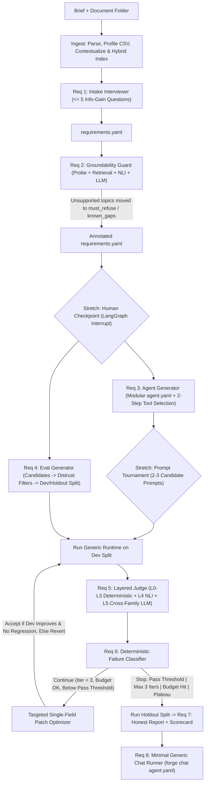

# ForgeAI — Master Implementation Plan

> [!NOTE]
> **Status:** Planning document only (no application code written yet).  
> **Scope:** All **9 mandatory core requirements** + all **6 optional stretch goals**, tailored to a **16 GB RAM + GTX 1650 (4 GB VRAM)** workstation and unattended live-review execution.

---

## 1. Executive Summary & Core Design Principles

**ForgeAI** is an autonomous **agent factory**—not a chatbot. Given a one-paragraph brief and a folder of documents, it interviews the requester, verifies groundability, generates a modular declarative agent definition (`agent.yaml`), synthesizes and filters an evaluation suite from the source documents, judges the agent with bias-resistant layered checks, diagnoses failures, applies targeted single-field patches in a bounded loop, and ships a runnable agent alongside an honest quality report.

### Five Core Design Principles

1. **Domain-Agnostic Unattended Execution:** Zero hardcoded domain logic (no HR or ship-spares rules in prompts or code). Every LLM call uses schema validation, retries, and deterministic fallbacks so an unseen brief never crashes mid-run.
2. **Deterministic Checks Before LLM Opinions:** Schema compliance, refusal flags, citation hits, exact numerical/key-fact matching, and tool-call traces are checked deterministically. Specialized local NLI models check claim-level grounding. An LLM judge handles only what remains.
3. **Distrust Your Own Pipeline:** Generated requirements, eval test cases, and judge verdicts are audited by independent checks (e.g., cross-model answerability filters, OOS retrieval checks, Cohen's κ calibration against hand-labeled examples).
4. **Targeted Fixes, Not Full Regeneration:** The agent definition is decomposed into named, independently patchable prompt sections and retrieval parameters. Each optimizer iteration modifies one targeted field, measures dev-set impact, and reverts regressions.
5. **Honest Reporting:** Evaluation uses a `dev` / `holdout` split. Final reports present the holdout score with a Wilson 95% confidence interval, per-category failure breakdowns, remaining known limitations, groundability gaps, and assumptions made in unattended mode.

---

## 2. Hardware-Aware Tech Stack & Model Architecture

Designed for **16 GB System RAM + NVIDIA GTX 1650 (4 GB VRAM)**:

| Layer | Selection | Rationale |
|---|---|---|
| **Orchestration** | **LangGraph** | Models the factory as a typed state machine with SQLite checkpointing (crash-resume, human-in-the-loop `interrupt`, bounded critic–optimizer loop). |
| **Typed LLM Calls** | **Pydantic v2 + Instructor / JSON Schema** | Enforces strict structured output with validate → repair → retry loops so small models never break downstream parsers. |
| **LLM Gateway** | Thin **OpenAI-compatible client** | Unified interface across providers (`--provider groq \| openrouter \| ollama`). Includes token-bucket TPM/RPM throttling, exponential backoff, and disk prompt-hash caching. |
| **Primary Hosted LLMs** | **Groq Free Tier** | Ultra-fast open-weight inference (~300+ tok/s) with zero local VRAM overhead. Ideal for unattended demos and free-tier Streamlit hosting. Model IDs verified dynamically via `/models`. |
| **Backup Hosted LLMs** | **OpenRouter (`:free`) / SambaNova Cloud** | Automatic failover if Groq hits rate limits or downtime, plus model-family diversity for the judge. |
| **Offline Local Fallback** | **Ollama** (`qwen2.5:3b`, `llama3.2:3b`, `gemma3:4b`) | Fits comfortably inside 4 GB VRAM for 100% offline execution if needed. |
| **Local Embeddings** | `BAAI/bge-small-en-v1.5` (~130 MB) | CPU-fast, zero API cost, strong retrieval quality. |
| **Local Reranker** | `cross-encoder/ms-marco-MiniLM-L-6-v2` (~90 MB) | Fast cross-encoder precision filter over fused retrieval candidates. |
| **Local Grounding (NLI)** | `cross-encoder/nli-deberta-v3-small` (~180 MB) | Sentence-level entailment classifier verifying whether claims are supported by retrieved chunks without relying on an LLM's self-opinion. |
| **Document Parsing** | **PyMuPDF4LLM** (primary) + **Docling** (fallback) | Fast deterministic Markdown extraction for born-digital PDFs; Docling fallback for scanned/OCR or complex multi-column/table PDFs. |
| **Tabular Data** | **pandas / DuckDB** | CSV files are profiled into schemas and queried deterministically via `csv_lookup`—never embedded as text chunks. |
| **Retrieval Index** | **BM25 + Embedded Vector Store (Chroma/LanceDB)** | Hybrid search merged via Reciprocal Rank Fusion (`k=60`), contextual chunk prepending at ingestion, and cross-encoder reranking. |
| **Observability** | **Local JSONL Trace Log** | Logs every call (`timestamp`, `node`, `model`, `prompt_hash`, `tokens_in`, `tokens_out`, `latency_ms`, `cached`) to feed budget enforcement and reports. |

### Cross-Family Model Role Assignment

To mitigate **self-preference bias**, the Judge and Eval Filter use a different model family from the Factory/Agent:

| Role | Primary (Groq) | Backup (OpenRouter `:free`) | Offline Fallback (Ollama, ≤4 GB VRAM) |
|---|---|---|---|
| **Factory Brain & Optimizer** | Qwen family (e.g., `qwen/qwen3-32b`) | `qwen/qwen3-8b:free` | `qwen2.5:3b` |
| **Generated Agent Runtime** | Llama family (e.g., `llama-3.1-8b-instant`) | `meta-llama/llama-3.1-8b-instruct:free` | `llama3.2:3b` |
| **LLM Judge & Answerability Filter** | Gemma / Qwen (different family from Agent) | `google/gemma-3-12b-it:free` | `gemma3:4b` |
| **Claim Grounding Classifier** | Local `cross-encoder/nli-deberta-v3-small` | Local NLI | Local NLI |

---

## 3. End-to-End Pipeline Architecture (All 9 Mandatory Core Requirements)



### Stage-by-Stage Specification

1. **Ingest & Document Inventory:**
   - Sniff file types: PDFs → Markdown (`PyMuPDF4LLM`, fallback to `Docling` if text yield is low or tables fail); CSVs → schema profile (columns, types, row counts, sample rows); MD/TXT/DOCX → plain text/Markdown.
   - Generate a **Document Inventory** (titles, summaries, key entities, topics) so the Intake Interviewer inspects corpus coverage without overflowing small-model context windows.
   - Split text on headings/sections first (token-bounded fallback), prepend a brief 1–2 sentence contextual header to each chunk (Contextual Retrieval), and index into BM25 + Chroma/LanceDB.
2. **Req 1 — Intake Interviewer:**
   - Takes the one-paragraph brief + Document Inventory.
   - Generates candidate clarifying questions, ranks them by expected information gain (ambiguities impacting scope, audience, or refusal boundaries), and asks **at most 5 questions**.
   - **Unattended mode:** Every question includes a model-proposed default answer; when running non-interactively, defaults are applied automatically and recorded with `assumed: true`.
   - Emits `requirements.yaml`: `scope`, `audience`, `tone`, `must_answer[]`, `must_refuse[]`, `assumptions[]`, `data_sources[]`.
3. **Req 2 — Groundability Guard:**
   - Generates 2–3 probe queries per `must_answer` topic, runs hybrid retrieval, and evaluates support via NLI + LLM verdict (`supported`, `partial`, `unsupported`).
   - Also checks implied capability needs (e.g., live calculations, weather, date) against available tools.
   - Unsupported topics are flagged, downgraded to `must_refuse` / `known_gaps`, and explicitly injected into the generated agent's refusal policy so it never hallucinates gaps away.
4. **Req 3 — Agent Generator:**
   - Produces a versioned, modular `agent.yaml`:
     - `system_prompt.sections`: `role`, `scope`, `grounding_rules`, `refusal_policy`, `tool_guidance`, `style`, `few_shot` (each independently patchable).
     - `retrieval`: `chunk_size`, `chunk_overlap`, `top_k`, `rerank_top_n`, `hybrid_alpha`, `min_relevance_score`, `query_rewrite`.
     - `tools` & `tools_rejected`: 2-step selection—(1) deterministic eligibility rules (e.g., CSV present → `csv_lookup` eligible), then (2) LLM selection requiring explicit evidence from the brief or docs. Unjustified tools are dropped and logged in `tools_rejected`.
     - `output_contract`: `{answer: str, citations: list[str], refused: bool, refusal_reason: str | None}`.
5. **Req 4 — Eval Generator:**
   - Generates ~40 candidate cases across 5 categories: single-hop answerable (stratified across docs), multi-doc synthesis (paired chunks sharing entities/neighbors), ambiguous phrasing (paraphrased queries), out-of-scope / near-domain adversarial (`should_refuse: true`), and tool-required cases (from CSV rows/math facts).
   - **Distrust Filters:**
     - *Independent Answerability Check:* A separate model tries to answer each answerable question given *only* its source chunk(s); unanswerable candidates are dropped.
     - *OOS Verification:* Retrieval + NLI must confirm out-of-scope cases are unsupported by the corpus.
     - *Dedup & Leakage Filter:* Drops near-duplicates (cosine similarity threshold) and verbatim chunk copies.
   - Retains 24–30 verified cases split into **`dev`** (used by optimizer) and **`holdout`** (touched only for final reporting). All generation prompts are committed in `forgeai/prompts/`.
6. **Req 5 — Layered Judge:**
   - **L0 (Deterministic):** Output contract valid? `refused` matches `should_refuse`?
   - **L1 (Deterministic):** Citation/retrieval hit on expected source document/chunk IDs.
   - **L2 (Deterministic):** Key-fact coverage (normalized numbers, dates, entities + fuzzy match).
   - **L3 (Deterministic):** Tool trace verification (expected tool called, expected computed value).
   - **L4 (NLI Model):** Sentence-level entailment via `nli-deberta-v3-small` against retrieved context.
   - **L5 (Cross-Family LLM Judge):** Pointwise, reference-guided fact-by-fact rubric (`present`/`absent` + evidence quote).
   - **Bias Defenses:** Pointwise reference-guided scoring eliminates A/B position bias (and tournament pairwise comparisons run swapped A/B + B/A orders); cross-family anonymization mitigates self-preference; atomic fact checklists eliminate verbosity bias. Judge agreement is calibrated with **Cohen's κ** against ~20 hand-labeled cases.
7. **Req 6 — Critic–Optimizer Loop:**
   - **Deterministic Failure Classifier** maps failures to: `retrieval_miss`, `hallucination`, `wrong_refusal`, or `prompt_defect` (an LLM adds natural-language root-cause commentary for the report).
   - **Targeted Patch Operators:**
     - `retrieval_miss` → adjust `top_k`, `hybrid_alpha`, `min_relevance_score`, `query_rewrite`, or `chunk_size` (re-index).
     - `hallucination` → tighten `grounding_rules`, add refusal `few_shot`, raise `min_relevance_score`.
     - `wrong_refusal` → clarify `scope`, soften `refusal_policy`, add positive `few_shot`.
     - `prompt_defect` → textual-gradient critique edits one specific prompt section (`tool_guidance`, `style`, etc.).
   - **Accept/Revert Gate:** Patch is accepted only if `dev` score improves without regressing previously passing cases (within threshold); otherwise reverted and logged.
   - **Four Stopping Conditions:** (1) Evals pass threshold reached (e.g., ≥ 90% dev pass & 100% must-refuse), (2) max 3 iterations reached, (3) token/latency budget exhausted, or (4) improvement plateau.
8. **Req 7 — Honest Reporting:**
   - Emits `scorecard.md` and `report.md` containing: per-iteration diff table, **holdout score with Wilson 95% confidence interval**, remaining failures grouped by root cause with concrete examples and hypotheses, groundability gaps, unattended assumptions, judge-human Cohen's κ, and token/latency accounting.
9. **Req 8 — Runnable Product:**
   - Minimal generic CLI chat runner (`forge chat runs/<id>/agent.yaml`) sharing the exact same runtime engine as the evaluation harness—loads any generated `agent.yaml`, attaches only declared tools, retrieves from the saved index, enforces the output contract, and displays citations.
10. **Req 9 — Two Full Demonstrations (+ Unseen Rehearsal):**
    - **Demo 1 (`hr_policy`):** HR Policy Assistant over policy PDFs (tests pure RAG, strict refusals, 0 tools attached).
    - **Demo 2 (`ship_spares`):** Ship-Spares Procurement Assistant over a parts catalogue CSV + supplier PDFs (tests `csv_lookup`, `calculator`, `current_date`, multi-source synthesis, and rejecting `weather_api`).
    - All synthesis prompts and full run artifacts (`requirements.yaml`, `agent_v*.yaml`, `evals.jsonl`, `iterations.jsonl`, `scorecard.md`, `report.md`, `traces.jsonl`) committed to the repo. Plus a 3rd unseen rehearsal brief tested before review.

---

## 4. All 6 Optional Stretch Goals

1. **Prompt Tournament:** Agent Generator proposes 2–3 distinct candidate system prompt strategies (e.g., terse-structured vs. chain-of-thought-grounded). Each is scored on the `dev` set plus position-swapped (A/B and B/A) pairwise LLM judge comparisons; the winner enters the optimizer loop, and the full comparison table appears in `report.md`.
2. **Budget Enforcement:** Configurable token and wall-clock latency budget per run tracked via `traces.jsonl`, triggering early stopping if remaining budget cannot sustain an iteration or if marginal score gain falls below a cost-effectiveness threshold.
3. **Human Checkpoint:** LangGraph `interrupt_before` node right after Groundability Guard allowing a human in interactive mode to inspect, edit, or approve `requirements.yaml` before generation proceeds (auto-approved in `--unattended` mode).
4. **Factory vs. Human Baseline:** Hand-write one of the two demo agents (`agent_human.yaml`) and evaluate it on the exact same `evals.jsonl` suite, documenting in `report.md` where ForgeAI outperforms the hand-crafted baseline and where it falls short.
5. **Regression Mode:** `forge regress <run_id> --docs <updated_dir>` detects document additions/modifications/deletions, re-indexes, regenerates/updates the agent, re-runs the prior `evals.jsonl`, and outputs a regression diff report showing newly broken vs. fixed cases.
6. **UI & Free-Tier Hosting:** A clean **Streamlit** web UI (`ui/app.py`) with two tabs—**Factory Runner** (brief input, document upload, live LangGraph progress, scorecard/report viewer) and **Agent Chat** (interactive chat with citations & tool trace)—deployed on **Streamlit Community Cloud** or **Hugging Face Spaces** using Groq/OpenRouter API keys via environment secrets.

---

## 5. Generic Tool Registry (4 Tools)

| Tool | Capability | Deterministic Eligibility Signal | Justification Required |
|---|---|---|---|
| `csv_lookup` | Filter, search, and aggregate rows in CSV files via pandas/DuckDB | At least one `.csv` file exists in the document folder | Brief or requirements mention tabular/catalogue/inventory lookup |
| `calculator` | Safe AST-evaluated arithmetic & unit/percentage calculations | Numeric figures/pricing/quantities detected in brief or docs | Brief or requirements involve computing totals, margins, dates, or formulas |
| `weather_api` | Keyless HTTP GET to `api.open-meteo.com` for current/forecast weather | Brief mentions weather, forecast, marine conditions, or port weather | Explicit weather/environmental need in brief (must be **rejected** for HR/spares) |
| `current_date` | Returns current UTC/local date and day-of-week | Temporal/validity/expiry/deadline queries detected in brief or docs | Brief or docs involve expiration dates, leave balances as of today, or lead times |

---

## 6. Repository Structure

```text
OceanAI/
├── Documentation/
│   ├── Starting_Info/
│   └── Plan/
│       └── ForgeAI_Master_Plan.md
├── forgeai/
│   ├── cli.py                  # Typer CLI: build, chat, eval, regress, report
│   ├── config.py               # Provider configs, model roles, budgets, thresholds
│   ├── llm/
│   │   ├── gateway.py          # OpenAI-compat client (Groq, OpenRouter, Ollama)
│   │   ├── structured.py       # Pydantic validation, repair & retry wrapper
│   │   ├── throttle.py         # Token-bucket TPM/RPM limiter & backoff
│   │   └── cache.py            # Disk prompt-hash cache & JSONL call tracer
│   ├── ingest/
│   │   ├── parsers.py          # PyMuPDF4LLM, Docling fallback, CSV profiler, DOCX/MD
│   │   ├── chunker.py          # Heading-aware chunker + contextual prepending
│   │   └── retriever.py        # BM25 + Chroma/LanceDB + RRF + MiniLM reranker
│   ├── tools/
│   │   ├── registry.py         # Tool specs, eligibility rules, attachment validator
│   │   ├── csv_lookup.py
│   │   ├── calculator.py
│   │   ├── weather_api.py
│   │   └── current_date.py
│   ├── schemas/                # Pydantic models: Requirements, AgentDef, EvalCase, Verdict, ChangeLog
│   ├── prompts/                # Versioned, committed prompt templates for every stage
│   ├── factory/
│   │   ├── graph.py            # LangGraph StateGraph + SQLite checkpointer + interrupt
│   │   ├── intake.py           # Req 1: Intake interviewer
│   │   ├── guard.py            # Req 2: Groundability guard
│   │   ├── generator.py        # Req 3: Agent generator + prompt tournament
│   │   ├── evalgen.py          # Req 4: Eval generator + distrust filters + split
│   │   ├── judge.py            # Req 5: Layered judge (L0-L5) + Cohen's κ tool
│   │   ├── classifier.py       # Req 6: Deterministic failure classifier
│   │   ├── optimizer.py        # Req 6: Targeted patcher + accept/revert + budget guard
│   │   └── report.py           # Req 7: Honest report & scorecard generator
│   └── runtime/
│       └── runner.py           # Req 8: Shared generic agent execution & CLI chat loop
├── ui/
│   └── app.py                  # Stretch: Streamlit Factory + Chat UI (HF Spaces / Cloud ready)
├── demos/
│   ├── hr_policy/              # Brief, synthetic/public HR PDFs, synthesis prompts
│   ├── ship_spares/            # Brief, parts CSV + supplier PDFs, synthesis prompts
│   └── human_baseline/         # Stretch: Hand-written baseline agent for comparison
├── runs/                       # Committed artifacts from Demo 1, Demo 2, and regression runs
└── tests/                      # Unit tests for deterministic checks, tools, & smoke pipeline
```

---

## 7. Phased Build Roadmap

| Phase | Focus | Key Deliverables & Exit Criteria |
|---|---|---|
| **Phase 0** | **Foundation** | Repo setup (`pyproject.toml`, dependencies), `config.py`, OpenAI-compatible `gateway.py` (Groq + OpenRouter + Ollama), TPM/RPM throttler, disk cache, JSONL tracer, and all Pydantic schemas. **Exit:** Structured call succeeds on all model roles + forced-malformed-JSON retry test passes. |
| **Phase 1** | **Ingest, Tools & Generic Runner** | Parsers (`PyMuPDF4LLM` + Docling fallback + CSV profiler), contextual hybrid retriever (`BM25 + bge-small + RRF + MiniLM reranker`), all 4 tools, and `runtime/runner.py` + `forge chat`. **Exit:** Can chat interactively with a test `agent.yaml` over sample docs with citations and selective tools. |
| **Phase 2** | **Eval Generator & Layered Judge** | Eval candidate synthesizer, distrust filters (cross-model answerability, OOS check, dedup/leakage), `dev`/`holdout` split, L0–L5 layered judge (`nli-deberta-v3-small` + cross-family LLM). **Exit:** Generates ~25 filtered cases; judge agreement achieves acceptable Cohen's κ on ~20 hand-labeled examples. |
| **Phase 3** | **LangGraph Core Factory** | Wire `StateGraph` with SQLite checkpointing, Intake Interviewer (≤5 questions + unattended defaults), Groundability Guard, and Agent Generator (sectioned prompt + 2-step tool selection). **Exit:** Produces a runnable `v0` agent end-to-end from a brief and doc folder. |
| **Phase 4** | **Critic–Optimizer Loop & Honest Reporting** | Deterministic failure classifier, targeted single-field patch operators, accept/revert gate, 4 stopping conditions, and `report.py` (Wilson 95% CI, per-iteration diff, root-cause failure summary). **Exit:** Full 3-iteration loop runs unattended with verifiable change logs and honest report. |
| **Phase 5** | **Full Demos & Unseen Rehearsal** | Create/synthesize Demo 1 (`hr_policy`) and Demo 2 (`ship_spares`) datasets + synthesis prompts; run full factory on both; commit all artifacts. Run a 3rd completely unseen rehearsal brief (`--unattended`) to harden edge cases. |
| **Phase 6** | **All 6 Stretch Goals** | Implement in priority order: (1) Budget enforcement, (2) Human checkpoint (`interrupt`), (3) Prompt tournament (with position-swap pairwise check), (4) Regression mode, (5) Factory vs. human baseline evaluation, (6) Streamlit UI + free-tier hosting deployment. |

---

## 8. Verification & Live Review Readiness Checklist

- [ ] **Automated Unit Tests (`pytest`):** Deterministic L0–L3 judge checks, failure classifier decision tree, tool eligibility/rejection logic, calculator AST safety, CSV lookup queries, Wilson CI math, and schema repair retries.
- [ ] **Unattended Smoke Test:** `forge build --brief ... --docs ... --unattended` runs end-to-end without prompts, handles missing/unsupported topics via Groundability Guard, and outputs valid artifacts.
- [ ] **Offline Fallback Verification:** `forge build --provider ollama` completes a scaled smoke run on GTX 1650 (4 GB VRAM) without internet access.
- [ ] **Selective Tool Audit:** Verify `hr_policy` attaches `[]` (rejects `csv_lookup`, `calculator`, `weather_api`, `current_date`) and `ship_spares` attaches `csv_lookup`, `calculator`, `current_date` (explicitly rejecting `weather_api`).
- [ ] **Committed Evidence:** Both demo runs (`runs/hr_policy/`, `runs/ship_spares/`), all prompts (`forgeai/prompts/`), and synthesis prompts (`demos/*/synthesis_prompts/`) are committed and reproducible.

